  

  

  

##  About Me

Mobile Developer building Android and iOS apps with **React Native**. Systems Analysis student focused on usability, performance and apps that feel native.

  

##  Tech Stack

<h3 align="left">Mobile</h3>

  
  

<h3 align="left">Languages</h3>

  
  

<h3 align="left">Backend & Web</h3>

  
  
  

<h3 align="left">Tools</h3>

  
  
  

  

##  Certifications

  
  

  

##  Contact

  
  

